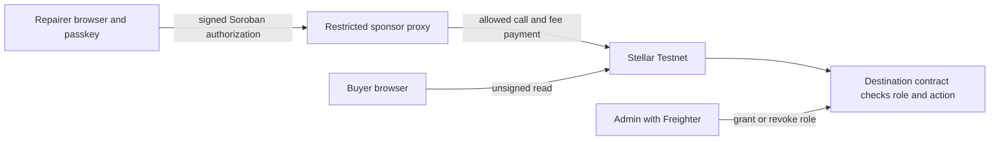

# Passkey-sponsored actions: implementation plan

**Status:** feasibility work in progress; account creation, role grant, sponsored repair, and passport readback were confirmed on an earlier Testnet contract. The current five-digit contract remains under test. **Network:** Stellar Testnet only. **First demonstration:** one repairer, one passkey smart account, explicit on-chain approval by the ReDevice administrator, and one sponsor-paid repair attestation. Buyers still open passports without a wallet.

### Feasibility work completed locally (25 October 2026)

- Baseline: 38 frontend tests, the fee-bump test, and 13 ReDevice contract tests pass. The production build passes and excludes the development-only passkey page.
- Pinned `smart-account-kit@0.8.0` and OpenZeppelin Channels client `0.21.0`. The app retains Stellar SDK `17.3.0`; Smart Account Kit installs its required SDK `16.4.1` separately. Downgrading the app itself broke XDR typechecking, so the cross-version signing path still needs the real Phase 1 proof.
- Live Testnet readback matched smart-account WASM `1b5f4534a76322da2ad7c745f6900857a6802b0ca79850c35a03561df997785a` and WebAuthn verifier `CC7EKIHQP3TN4CARQDND6CEOY2UXLWWC2X5GHTD5NLAT7BG5GPZIOM3F` (WASM hash `e63a030d0f1a1481e36059a4837c433083b33e704c1f9625b7314795b6d72b76`).
- Testnet RPC reports protocol 29. The local feasibility target is `CDSP64KAEVFZ5QU3U2AMTNFWWF3CHEXRCFBSXWDESF6QSR3SHU2CWZCT` with WASM hash `77bb782f87eee60ad687fa78cf31c4b2e221e4a12469ce657438a1d3ef2d22d0`. A public read confirms device 1 is currently `Refurbished` with one repair; the next test transition is `Repaired`.
- A **local-only** sponsor spike (`scripts/passkey-spike-sponsor.mjs`) listens on loopback, accepts one pinned smart-account creation or one attestation on the configured ReDevice contract, and keeps its Testnet Channels key outside the repository. `node --test scripts/passkey-spike-policy.test.mjs` verifies its narrow XDR allowlist, including rejection when call arguments change after signing. This is not the durable, rate-limited service in Phase 3 and must not be published.
- `http://localhost:5173/passkey-spike` is a development-only browser harness. Its account creation and repair signing still need a real laptop passkey test. The admin screen now accepts `C...` Repairer addresses. The local harness currently targets the earlier Akif-administered Testnet contract because that is the contract in this laptop's `.env.local`; any result must be labeled with its exact contract ID.
- A Vercel **Preview-environment** version of the same harness is assigned to the single public hostname [redevice-six.vercel.app](https://redevice-six.vercel.app). It needs `VITE_PASSKEY_TESTING=true`, `VITE_STELLAR_CONTRACT_ID`, `PASSKEY_TEST_ENABLED=true`, `PASSKEY_REDEVICE_CONTRACT_ID`, `PASSKEY_ALLOW_CREATE=true`, a private `PASSKEY_TEST_TOKEN`, and a server-only `CHANNELS_API_KEY`. The function checks a same-origin test session, the exact signed Soroban call, and the repairer's live on-chain role. This lets that hostname handle account creation and a repair after admin approval, without redeploying between them. This temporary feasibility endpoint has no durable spend cap or rate counter and must not be used as the general sponsor service.

## Decisions and success criteria

- Each repairer controls a separate passkey smart-account address (`C...`). They approve each action on their device and need no extension, seed phrase, or XLM. The administrator controls sponsorship and grants or revokes the on-chain Repairer role. The administrator never holds the repairer's passkey.
- A separate sponsor supplies the transaction source and fees. The passkey authorizes the exact Soroban call. The destination contract decides whether the account may perform it; sponsor policy decides only which calls the project will pay for.
- Preserve Freighter registration, repair, and administration during rollout; public passport routes, QR scanning, PDF export, and earlier Sui history stay intact. Confirmed on-chain success and public record readback are separate states.
- The shared layer is not considered reusable until a **second, different contract** uses it without ReDevice-specific branches.
- An invite system, automated staff identity checks, and mainnet launch are separate product work. For the first demonstration, the admin manually approves one account and its sponsorship. Never expose an unrestricted public account-creation relay.

## Current code and compatibility hypothesis

| Existing code                                | Required work                                                                                                                                                                                    |
| -------------------------------------------- | ------------------------------------------------------------------------------------------------------------------------------------------------------------------------------------------------ |
| `stellar/contracts/redevice/src/lib.rs`      | `attest_repair` calls `repairer.require_auth()` and checks on-chain `Role::Repairer` for an `Address`. A `C...` smart account may work **without changing ReDevice**; prove it on Testnet first. |
| `web/src/stellar/client.ts`                  | Add a separate passkey repair path while retaining Freighter. Share ReDevice field validation/request IDs/readback with its adapter, not the reusable package.                                   |
| `web/src/Admin.tsx` and `changeRepairerRole` | Grant/revoke Repairer for a valid smart-account `C...` as well as a `G...`; show and verify the exact address before the admin signs.                                                            |
| `web/src/App.tsx`                            | Add passkey create/reconnect and repair authorization. Public reads must remain disconnected.                                                                                                    |
| `vercel.json`                                | Keep `/api/*` sponsor functions reachable alongside the SPA fallback; verify in a deployed preview.                                                                                              |

The live ReDevice contract currently issues sequential IDs. The uploaded five-digit-ID WASM is a separate deployment decision; this feature must pin the exact contract ID it targets and must not silently move existing passport data.

## Architecture and trust boundaries



Pin an exact `smart-account-kit`, Stellar SDK, and relayer version. Verify the kit's published Testnet account WASM, WebAuthn verifier, and protocol compatibility against RPC before use. The SDK/integration layer is pre-1.0 and unaudited as a whole, so keep this phase on Testnet. The sponsor key belongs only in a server secret; never in `VITE_*`, browser code, public logs, or commits. OpenZeppelin Channels is a candidate fee payer behind the proxy and has a fair-use limit. [Smart Account Kit](https://github.com/stellar/smart-account-kit), [OpenZeppelin Channels](https://docs.openzeppelin.com/relayer/guides/stellar-channels-guide).

Stellar permits a contract account to authorize through `Address.require_auth()` and handles auth nonce/expiry replay protection. ReDevice's request ID adds application-level idempotency. A sponsor cannot produce the repairer's valid authorization and must not alter the signed operation. [Stellar authorization](https://developers.stellar.org/docs/learn/fundamentals/contract-development/authorization).

## Roadmap and acceptance gates

Complete each gate before dependent work. Keep a Testnet evidence note with public identifiers and no credentials.

### 0. Baseline and dependency pin

1. Record checkout commit, ReDevice contract ID/WASM hash, Testnet protocol, administrator address, and five-digit-ID deployment state.
2. Pin exact library versions and verify the smart-account WASM and verifier artifacts from the kit's current deployment manifest and RPC. Confirm WebAuthn works on the intended HTTPS origin and demonstration device.
3. Select a sponsor runtime and durable store for idempotency and spend counters. Set a Testnet fee budget and manual sponsorship kill switch.

**Gate:** baseline checks pass, public artifact IDs are recorded, and no sponsor secret is in the browser bundle.

### 1. Feasibility: one real sponsored repair

1. Create one disposable passkey smart account on Testnet with a private, admin-controlled sponsor setup. The repairer keeps the passkey on their device; the `C...` account holds no XLM.
2. Use Freighter administration to grant that exact `C...` ReDevice's Repairer role; verify `has_role` on-chain.
3. Build a direct `attest_repair(repairer=C..., request_id, device_id, ...)` call. Simulate, prompt for passkey approval of that actual call, and submit with a **different funded fee payer**. Try the kit's direct signed-call path first; use another SDK path only if the resulting auth tree binds the ReDevice call and all its arguments.
4. Wait for final `SUCCESS`, read the repair back, and confirm its repairer is the `C...` account. Record transaction hash, signer, fee payer, final status, fee, and readback.

**Gate:** one real passkey prompt yields one sponsor-paid repair without Freighter or XLM for the repairer. If this fails, identify the exact SDK, auth-tree, contract, or relayer incompatibility before package or UI work. Mocks do not satisfy this gate.

### 2. Extract a ReDevice-independent package

Create `packages/stellar-passkey-actions/` with browser and server entry points. Browser code handles account creation/reconnection, operation-specific signing, sponsor submission, finality tracking, and typed errors. Server helpers decode XDR and match configured policies; they contain no relayer key. The package must not import ReDevice, `device_id`, `repair_type`, or Repairer roles. Each app provides its own call arguments, on-chain role rules, and final record readback.

Proposed API; finalize its exact types from the proven Phase 1 SDK sequence:

```ts
type PermittedCall = {
  networkPassphrase: string;
  contractId: string;
  method: string;
  args: unknown[]; // encoded by the pinned Stellar SDK
  actor: string; // passkey smart-account C... address
  requestId: string;
};

type ActionResult =
  | { state: "pending" | "unknown"; requestId: string; hash?: string }
  | { state: "confirmed"; requestId: string; hash: string; result: unknown }
  | { state: "failed"; requestId: string; hash?: string; error: ActionError };

interface SponsoredActions {
  createAccount(): Promise<string>;
  reconnectAccount(): Promise<string | null>;
  authorizeAndSubmit(call: PermittedCall): Promise<ActionResult>;
  getStatus(requestId: string): Promise<ActionResult>;
}
```

Document canonical argument encoding, signed-payload format, typed errors, and the required sponsor policy. Keep `requestId` stable across reloads. No generic "sign any transaction" shortcut or role decision belongs in the package. A small ReDevice adapter maps repair fields to the call and verifies repair readback.

**Gate:** package tests cover reconnection, canceled passkey prompt, changed arguments after signing, expired auth, relayer refusal, unknown finality, and reload with a pending request. No ReDevice import appears in the package.

### 3. Restricted sponsor service

Implement a server-only proxy with **one configured policy per integrating app**. Each policy pins Testnet, contract ID, method, allowed operation shape, maximum payload size, resource/fee limits, per-account rate, and project spend cap. ReDevice's policy permits `attest_repair`; smart-account creation is separately controlled for the first demo. There is no arbitrary transaction or XDR relay.

Decode the submitted operation and auth entry, verify that signer/auth tree match the exact call and arguments, reject extra operations, and re-simulate before paying. Check active role for fast rejection where available; the destination contract is authoritative. Persist status by `(network, contract, actor, requestId)` with atomic claim/finality updates. Preserve a submitted hash after timeouts. Use durable rate/spend counters across serverless instances and a kill switch that leaves public reads working.

For the first account, admin approval can be a server-side operator action plus an explicit on-chain grant. Do not add invite links or automated identity claims. Before expanding enrollment, design separate authenticated admin provisioning; a client-supplied `admin=true` flag is insufficient.

**Gate:** tests reject wrong network, contract, method, altered args, signer mismatch, expired auth, extra operation, oversized payload, excessive fees, duplicate submissions, and requests over the spend cap. Verify hosted `/api/*` routing and absence of relayer credentials from build artifacts and responses.

### 4. ReDevice browser integration

1. Let a repairer create or reconnect their passkey account and copy the public `C...` address. The admin manually checks it and grants Repairer using Freighter. Update the admin form to accept a valid `C...` while retaining `G...` support.
2. Let the repairer open/scan a passport and review exact device, repair type, public notes, resulting status, battery health, and claimed service time before signing.
3. Require a **fresh passkey prompt per attestation**. Session restore must not sign. Submit through the restricted sponsor and show `pending`, `confirmed`, `failed`, or `unknown`; retain hash/request ID across refresh. Claim completion only after final success **and** repair readback. A confirmed transaction with failed readback is reported as confirmed on-chain with a readback problem, never as permission to submit again.
4. Keep the Freighter repair path during rollout. Verify a buyer can read the passport, QR, and PDF in a clean browser without a wallet.

**Gate:** a clean repairer browser completes a sponsored repair without Freighter or XLM; canceling the passkey prompt submits nothing; revocation blocks the next repair; public routes and exports still work.

### 5. Independent reuse proof

Add `stellar/contracts/milestone-demo/`, a tiny second Soroban contract with an independently role-gated method such as `approve_milestone(approver, request_id, milestone_id)`. Its own admin grants/revokes Approver; the method requires that account's authorization and emits a readable approval. Create a **separate sponsor policy** for its contract and method.

Build a minimal second app/page using the documented package API, without modifying package internals or copying ReDevice fields into it. Submit a real Testnet passkey approval with a sponsor-paid transaction and public readback. Document exactly what code is shared versus app-specific adapter/policy configuration. Keep this demo out of ReDevice's main navigation.

**Gate:** `attest_repair` and `approve_milestone` both work through the same package and policy engine on Testnet. Until then, the reusable layer is incomplete.

### 6. Verification, operations, and release decision

- Test unauthorized/revoked accounts, changed signed arguments, canceled prompts, expired auth, duplicate request IDs, relayer refusal, unknown finality, reload during submission, and final success followed by failed readback. Include raw contract calls, not just UI guards.
- Run `npm run format:check`, `npm run typecheck`, `npm test`, `npm run test:fee-bump`, `npm run build`, formatting/tests/build for changed contracts, and real Testnet flows on a supported passkey device. Exercise mobile and desktop if both are target devices.
- Document setup, package API, app policy format, trust boundaries, Testnet identifiers and hashes, fee payer/budget, public transaction evidence, revocation, and recovery limits. Lost-device response for the first release is admin revocation followed by a new account and role grant; adding a second passkey signer needs separate testing.
- Review the sponsor's abuse surface and project spend before a hosted pilot. Testnet completion does not imply mainnet readiness.

**Gate:** both applications pass checks and live demonstrations; a reviewer can identify the signer, fee payer, contract decision, and final record for each action.

## Work split without file conflicts

- **Akif:** feasibility transaction, pinned SDK/relayer setup, reusable package, sponsor policy engine, and Testnet evidence. Own `packages/stellar-passkey-actions/`, `api/`, and sponsor configuration.
- **Yhlas:** ReDevice repairer/admin UI, buyer regressions, second demo app and contract, and user-facing setup notes. Own new UI/example files and `stellar/contracts/milestone-demo/`.
- Agree on the package API and status/error types after Phase 1. Only one person edits `web/src/App.tsx`, `web/src/Admin.tsx`, or `web/src/stellar/client.ts` at a time. Cross-review sponsor policy and on-chain authorization before deployment.

## Primary references

- [Stellar smart contract authorization](https://developers.stellar.org/docs/learn/fundamentals/contract-development/authorization): smart-account `Address` authorization and replay handling.
- [Smart Account Kit](https://github.com/stellar/smart-account-kit) and its [Testnet deployment artifacts](https://github.com/stellar/smart-account-kit/blob/main/docs/deployments-protocol-27-2026-07-09.md): SDK, security notes, version-specific addresses/hashes.
- [OpenZeppelin Channels](https://docs.openzeppelin.com/relayer/guides/stellar-channels-guide): sponsored Soroban calls and service limits.
- [Vercel Functions](https://vercel.com/docs/functions) and [rewrites](https://vercel.com/docs/routing/rewrites): sponsor endpoint deployment and SPA routes.
